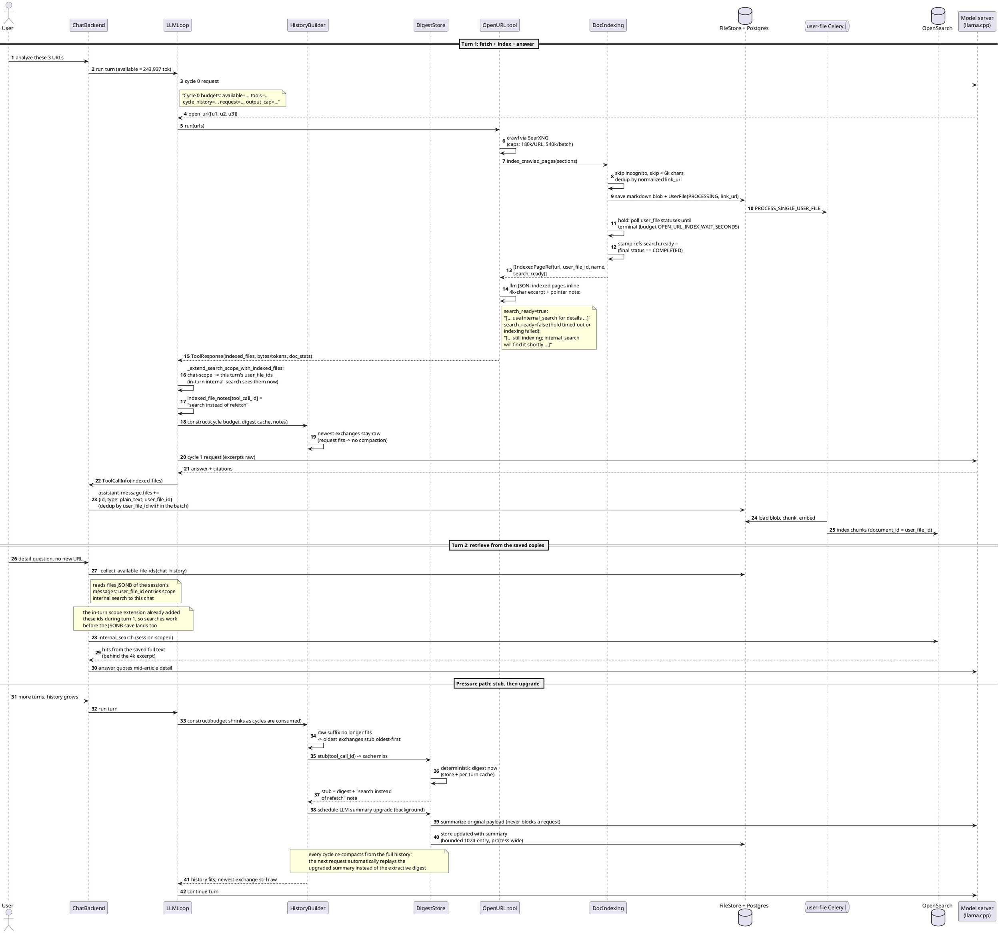
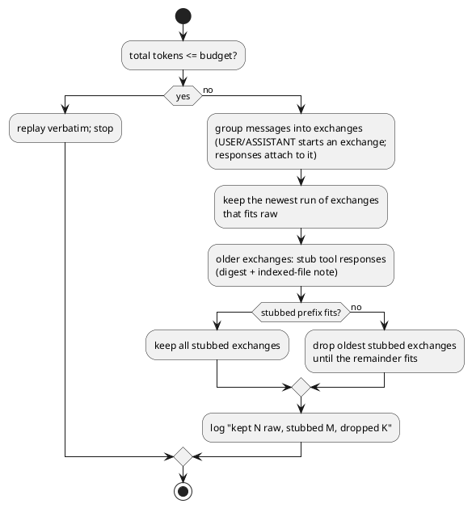

# Token-pressure flow: indexed crawls, lazy digests, oldest-first compaction

How a regular chat turn behaves under context pressure after the
token-pressure optimization work (2026-10/11). Live budgets derive from the
selected model's context window (probe -> LiteLLM map -> 32k fallback); on
this deployment: window 262,144, input budget 243,937 (0.05 margin).

Design rules, in the order they apply:

1. **Fetch is decoupled from context.** `open_url` may fetch up to 180k
   chars per URL / 540k per batch. Pages at or above 6k chars are saved as
   indexed user files; the model inlines only a 4k-char excerpt plus a
   pointer (`indexed_as`) per saved page.
2. **Newest content stays raw.** When the in-turn tail overflows, the newest
   exchanges replay verbatim; older exchanges stub (digest + note), then
   drop, oldest first. Same for history before the last user message on
   later turns.
3. **Digests are lazy.** A stub carries a deterministic digest immediately;
   an LLM summary upgrade runs in the background and later re-compactions
   pick it up. Nothing on the request path waits for an LLM.
4. **Stubbed pages point at searchable copies.** Saved pages carry the
   session's internal search scope (via the assistant message's file
   descriptors), so the model retrieves details instead of re-fetching.
5. **The response waits for the searchable copy.** `open_url` holds its
   answer (bounded by `OPEN_URL_INDEX_WAIT_SECONDS`, 2s polls) until the
   freshly saved pages reach a terminal indexing state; the pointer note
   only promises `internal_search` once the file is really searchable
   (`IndexedPageRef.search_ready`, stamped from the final status).

## Main sequence: fetch, index, answer, search later

## Compaction decision (both in-turn tail and cross-turn history)

## Where the code lives

| Piece | Location |
| --- | --- |
| Cycle budget + ledger, compaction, history fit | `backend/onyx/chat/llm_loop.py` |
| Mid-turn search-scope extension (`extend_search_scope_with_indexed_files`, shared with DR sub-agents) | `backend/onyx/chat/llm_loop.py` |
| Digest cache/store, lazy tier-2 upgrade | `backend/onyx/chat/tool_response_digest.py` |
| Crawled-page indexing + hold-until-searchable | `backend/onyx/tools/tool_implementations/open_url/doc_indexing.py` (`_wait_until_searchable`) |
| Excerpt, pointer note gating, `indexed_as` | `backend/onyx/tools/tool_implementations/open_url/open_url_tool.py` (`_inline_content_for_section`) |
| Assistant-message file descriptors (batch dedup) | `backend/onyx/chat/save_chat.py` (step 9) |
| Ratios and caps | `backend/onyx/llm/context_budgets.py`, `backend/onyx/configs/app_configs.py` |
| DR orchestrator / final report (digests wired through) | `backend/onyx/deep_research/dr_loop.py` |
| DR research sub-agent (digests, indexed-file notes, run-wide scope extension) | `backend/onyx/tools/fake_tools/research_agent.py` |

## Deep Research under the same rules

The DR orchestrator and its research sub-agents run their own cycles but
build every request through the same `construct_message_history`, so the
compaction machinery applies there too. Wired and live-verified
2026-11-04 (run with a temporary 16k sub-agent cap: 4 compaction rounds,
tier-1 digests on stubs, tier-2 upgrades attempting with deterministic
fallback):

- The orchestrator keeps one digest cache per run; the final report and
  every orchestrator cycle replay digested sub-agent reports instead of
  bare notices when the history overflows. A 48h run (the deployment's
  `DR_FORCE_REPORT_S`) overflows many times — digests are what survive.
- Sub-agents keep per-call digest + note caches; their own overflow
  stubs carry digests and the indexed-file note.
- Pages a sub-agent saves via `open_url` extend the run-wide search
  scope immediately, so later sub-agents retrieve them instead of
  re-fetching the same URLs.

Also live-verified 2026-11-04: thinking models can end the intermediate
report step with an empty answer at `finish_reason=stop` (the report
lands in the reasoning trace, sometimes with further searches planned
that the tool-less step cannot run). The retry now appends an explicit
report nudge (`RESEARCH_REPORT_RETRY_NUDGE`) alongside the doubled
generation budget; run 2 wrote both intermediate reports and a cited
final answer without triggering it. Regression test:
`backend/tests/unit/onyx/deep_research/test_dr_compaction_wiring.py`.

Known limitations:
- Tier-2 digest upgrades run on the primary engine and race the DR loop
  for it; under load they time out into the deterministic fallback (by
  design). Routing them to the secondary model is the follow-up.
- A compacted sub-agent report can lose its citation markers, so the
  final report may under-cite documents that stayed in
  `final_documents`. The citation ledger idea (marker -> doc + one-line
  claim, compacted last) is the follow-up if live runs show
  under-citing.

## Live values (this deployment)

| Knob | Value |
| --- | --- |
| Input budget / safety margin | 243,937 tok / 0.05 |
| `MAX_LLM_CYCLES` | 12 (22 for scheduled runs) |
| Fetch caps | 180,000 chars/URL, 540,000/batch |
| Index threshold / inline excerpt | 6,000 / 4,000 chars |
| Hold-until-searchable budget | `OPEN_URL_INDEX_WAIT_SECONDS` 90 (2s polls; 0 disables) |
| `MAX_CHUNKS_FED_TO_CHAT` | 10 (bounds the selection prompt and the search feed; at 512-tok chunks 50 blew the 9B-era selection prefill past every budget) |
| `SECONDARY_LLM_FLOW_TIMEOUT_S` | 600 (secondary flows run on the GPU pair; thinking off via provider `extra_body`) |
| `TOOL_EXECUTION_TIMEOUT_SECONDS` | 1200 — the search tool's whole batch must fit inside this |
| Digest stub cap / summary output | 2,400 chars / 11/1250 of window (~2,259 tok) |
| Summary input cap | 400,000 chars (head+tail kept) |
| Cross-turn digest store | 1,024 entries, in-process |
| In-flight digest upgrades | max 4 |
