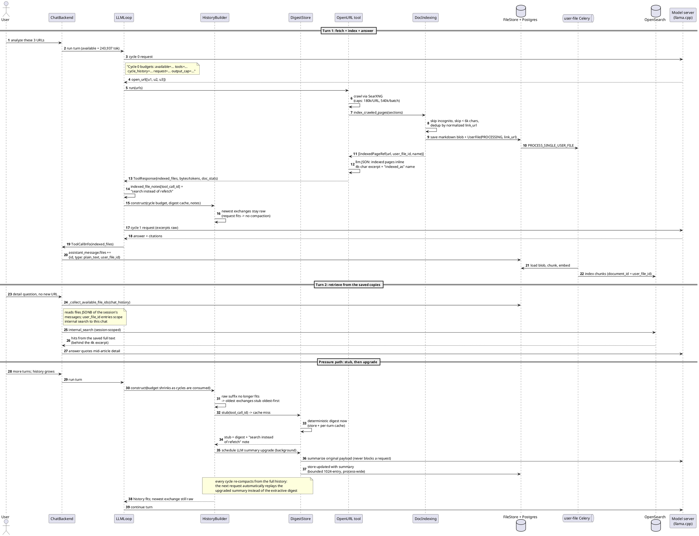
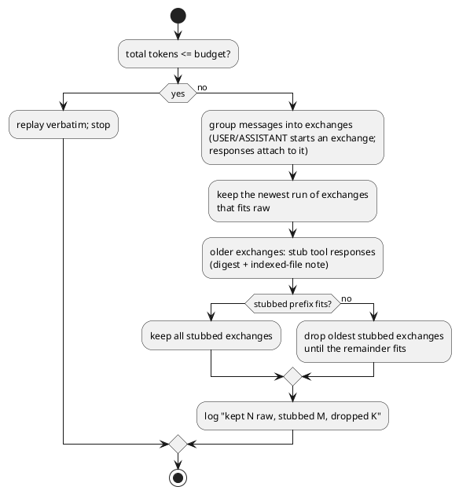

# Token-pressure flow: indexed crawls, lazy digests, oldest-first compaction

How a regular chat turn behaves under context pressure after the
token-pressure optimization work (2026-10/11). Live budgets derive from the
selected model's context window (probe -> LiteLLM map -> 32k fallback); on
this deployment: window 262,144, input budget 243,937 (0.05 margin).

Design rules, in the order they apply:

1. **Fetch is decoupled from context.** `open_url` may fetch up to 180k
   chars per URL / 540k per batch. Pages at or above 6k chars are saved as
   indexed user files; the model inlines only a 4k-char excerpt plus a
   pointer (`indexed_as`) per saved page.
2. **Newest content stays raw.** When the in-turn tail overflows, the newest
   exchanges replay verbatim; older exchanges stub (digest + note), then
   drop, oldest first. Same for history before the last user message on
   later turns.
3. **Digests are lazy.** A stub carries a deterministic digest immediately;
   an LLM summary upgrade runs in the background and later re-compactions
   pick it up. Nothing on the request path waits for an LLM.
4. **Stubbed pages point at searchable copies.** Saved pages carry the
   session's internal search scope (via the assistant message's file
   descriptors), so the model retrieves details instead of re-fetching.

## Main sequence: fetch, index, answer, search later

## Compaction decision (both in-turn tail and cross-turn history)

## Where the code lives

| Piece | Location |
| --- | --- |
| Cycle budget + ledger, compaction, history fit | `backend/onyx/chat/llm_loop.py` |
| Digest cache/store, lazy tier-2 upgrade | `backend/onyx/chat/tool_response_digest.py` |
| Crawled-page indexing | `backend/onyx/tools/tool_implementations/open_url/doc_indexing.py` |
| Excerpt + `indexed_as` in the LLM JSON | `backend/onyx/tools/tool_implementations/open_url/open_url_tool.py` |
| Assistant-message file descriptors | `backend/onyx/chat/save_chat.py` (step 9) |
| Ratios and caps | `backend/onyx/llm/context_budgets.py`, `backend/onyx/configs/app_configs.py` |

## Live values (this deployment)

| Knob | Value |
| --- | --- |
| Input budget / safety margin | 243,937 tok / 0.05 |
| `MAX_LLM_CYCLES` | 12 (22 for scheduled runs) |
| Fetch caps | 180,000 chars/URL, 540,000/batch |
| Index threshold / inline excerpt | 6,000 / 4,000 chars |
| Digest stub cap / summary output | 2,400 chars / 11/1250 of window (~2,259 tok) |
| Summary input cap | 400,000 chars (head+tail kept) |
| Cross-turn digest store | 1,024 entries, in-process |
| In-flight digest upgrades | max 4 |
